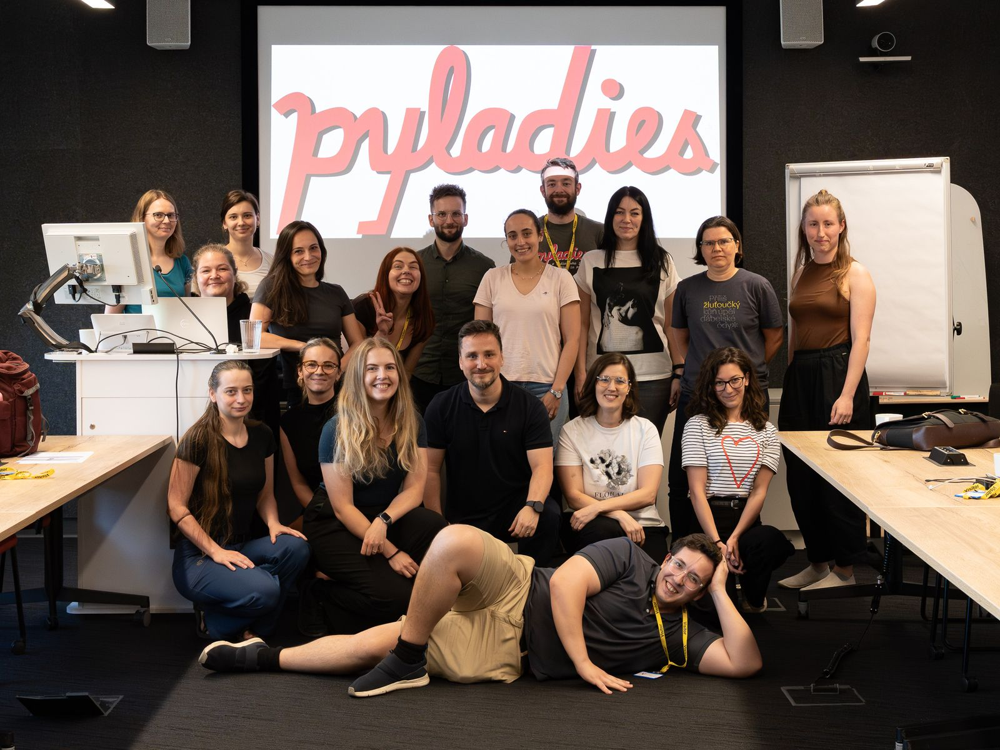

> [!NOTE]
> 🇨🇿 **Česká verze:** [klikněte sem](https://github.com/pyladiesprague)

# Welcome to PyLadies Prague 🐍

We are the Prague chapter of [PyLadies](https://pyladies.cz/praha/). We run **beginner Python courses for women**, taught by volunteer coaches from the industry. No previous programming experience needed.

**The courses are taught in Czech**, and so are the materials in this organization.

- 📚 **Lesson materials:** [pyladiesprague/materialy](https://github.com/pyladiesprague/materialy)
- 🌐 **Course website:** [schedule and lessons](https://pyladies-public-pages.pyladies-d3a.workers.dev/)
- ✉️ **Contact and sign-up:** [pyladies.cz/praha](https://pyladies.cz/praha/)

**Follow us:** [LinkedIn](https://www.linkedin.com/company/pyladies-prague/) · [Instagram](https://www.instagram.com/pyladiesprague/) · [Facebook](https://www.facebook.com/profile.php?id=61576503929491)

Want to coach, host a lesson or support us as a company? Get in touch via [pyladies.cz/praha](https://pyladies.cz/praha/).
