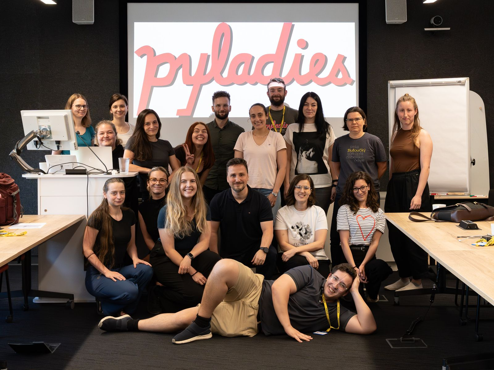

> [!NOTE]
> 🇬🇧 **English version:** [click here](https://github.com/pyladiesprague/.github/blob/main/profile/README.en.md)

# Vítejte u PyLadies Prague 🐍

Jsme pražská pobočka [PyLadies](https://pyladies.cz/praha/). Pořádáme **začátečnické kurzy programování v Pythonu pro ženy**, vedou je dobrovolní kouči a koučky z praxe. Nepotřebujete žádné předchozí zkušenosti s programováním, jen chuť se učit.

## Jak kurz probíhá

- **13 lekcí**, každý čtvrtek večer, plus dva sobotní workshopy (opakování s projektem v půlce kurzu a závěrečný projekt na konci).
- Od úplných základů (první program, podmínky, cykly, funkce) přes řetězce, seznamy a slovníky až k třídám a práci s daty.
- Na každé lekci je výklad a pak hlavně vlastní práce s pomocí koučů u stolu.
- Domácí úkoly řešíte ve svém forku repozitáře s materiály, s čímkoli se můžete ozvat na Discordu.

## Kde co najdete

| | |
| --- | --- |
| 📚 **Materiály k lekcím** | [pyladiesprague/materialy](https://github.com/pyladiesprague/materialy), každá lekce ve vlastní složce (výklad, tahák, cvičení, řešení) |
| 🌐 **Web kurzu** | [harmonogram, místa konání a výklad lekcí](https://pyladies-public-pages.pyladies-d3a.workers.dev/) |
| 💬 **Discord** | hlavní komunikační kanál kurzu, pozvánku dostanete e-mailem po přijetí do kurzu |
| ✉️ **Kontakt a přihlášky** | [pyladies.cz/praha](https://pyladies.cz/praha/) |

## Sledujte nás

[LinkedIn](https://www.linkedin.com/company/pyladies-prague/) · [Instagram](https://www.instagram.com/pyladiesprague/) · [Facebook](https://www.facebook.com/profile.php?id=61576503929491)

Přihlášky na další běh oznamujeme na sítích a na [pyladies.cz/praha](https://pyladies.cz/praha/).

## Chcete se zapojit?

Hledáme kouče a koučky na lekce i pomoc s materiály. Jak na to, najdete na stránce [Přidej se k nám](https://pyladies-public-pages.pyladies-d3a.workers.dev/o-nas/pridej-se/). Chyby a návrhy k materiálům hlaste podle [návodu pro přispěvatele](https://github.com/pyladiesprague/.github/blob/main/CONTRIBUTING.md).
